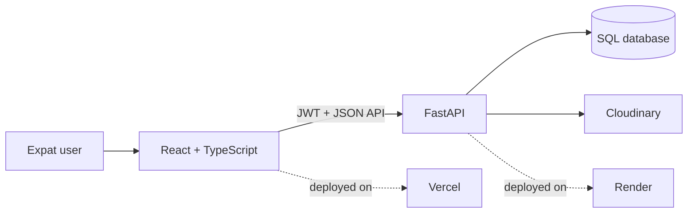

<div align="center">

# Expat Ease

### Your digital companion for settling into a new country

Country-specific guidance, documents, local services, and community support—all in one place.

[](https://react.dev/)
[](https://www.typescriptlang.org/)
[](https://fastapi.tiangolo.com/)
[](https://vite.dev/)


[Explore the app](https://expat-ease.vercel.app) · [API documentation](https://expat-ease.onrender.com/docs) · [Report an issue](https://github.com/prajwalreddypr/Expat-Ease/issues)

</div>

## Why Expat Ease?

Moving countries means navigating unfamiliar systems all at once. Expat Ease turns that process into a clear journey:

| Plan your move | Keep documents together | Find local help | Learn from others |
|---|---|---|---|
| Follow country-specific settlement steps and track progress. | Upload and organize documents linked to each step. | Discover essential services for daily life and administration. | Ask questions, share answers, vote, and connect through the forum. |

## How it fits together



## Technology

| Layer | Technologies |
|---|---|
| Frontend | React 19, TypeScript 5.8, Vite 7, React Router 7, Tailwind CSS 3 |
| Backend | Python, FastAPI, SQLModel, Alembic |
| Security | JWT authentication and bcrypt password hashing |
| Data | SQLite by default; `DATABASE_URL` supports PostgreSQL |
| Files | Cloudinary |
| Quality | Ruff, Pytest, ESLint, Vitest, React Testing Library |
| Hosting | Vercel frontend and Render backend |

## Repository layout

```text
expat-ease-frontend/  React application
expat-ease-backend/   FastAPI application and migrations
PROJECT_OVERVIEW.md   Detailed architecture and domain overview
```

## Local setup

### Backend

```powershell
cd expat-ease-backend
python -m venv venv
.\venv\Scripts\Activate.ps1
pip install -r requirements.txt
pip install -r requirements-dev.txt
Copy-Item .env.example .env
python -m app.db.migrate
python -m uvicorn app.main:app --reload --port 8000
```

API documentation is available at <http://localhost:8000/docs>.

### Frontend

```powershell
cd expat-ease-frontend
npm install
Copy-Item .env.example .env
npm run dev
```

The frontend is available at <http://localhost:5173> and uses `VITE_API_URL` for the backend base URL.

## Quality checks

Run these before opening a pull request:

```powershell
cd expat-ease-backend
python -m ruff format --check app tests
python -m ruff check app tests
python -m pytest -q

cd ..\expat-ease-frontend
npm run lint
npm run typecheck
npm test
npm run build
```

## Git workflow

1. Update `dev`.
2. Create an issue branch from `dev`, such as `38-frontend-forum-utils-refactor`.
3. Keep each branch focused on one bounded change.
4. Use issue-linked commits, for example:

   ```text
   [#38] Frontend: Forum - Reuse shared date formatting
   ```

5. Open a pull request from the feature branch into `dev`.
6. After validation, merge `dev` into deployable `main`.

Production hotfixes may branch from `main`; merge the completed hotfix back into `dev` afterward.

## Deployment

The backend must run migrations before starting:

```bash
python -m app.db.migrate && uvicorn app.main:app --host 0.0.0.0 --port $PORT
```

The frontend build command is `npm run build`, with output in `dist/`.

## Additional documentation

- [Frontend README](expat-ease-frontend/README.md)
- [Backend README](expat-ease-backend/README.md)
- [Project overview](PROJECT_OVERVIEW.md)
